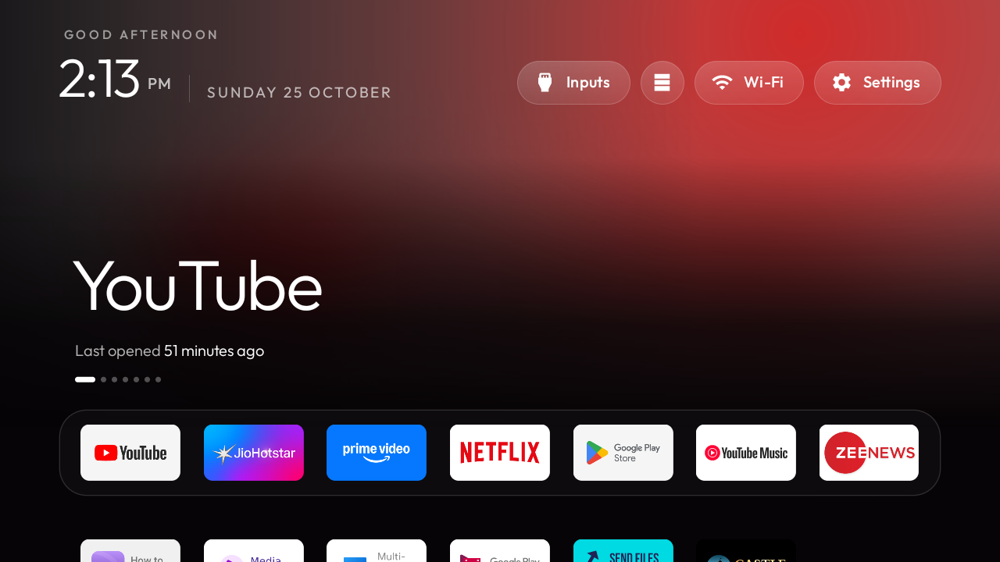

<p align="center">
  
</p>

# 📺 CleanTV Home — 1-Click Seamless TV Setup

> **Transform your Android TV into an ultra-clean, ad-free, Apple TV-style experience in under 2 minutes.**  
> *No root required. No cables required (works over Wi-Fi). Zero technical dependencies. 1-click instant restore.*

---

## ⚡ Highlights

* **🍎 Apple TV Aesthetic**: Pitch-black background, floating glass highlights, smooth animations, and top-shelf focus glowing with the active app's theme.
* **🚫 Zero Ads & Sponsored Junk**: Strips away OEM carousels, Google TV recommendations, background telemetry, and vendor bloatware.
* **📦 Ready to Run**: Comes with pre-compiled signed release APKs (`com.gathin.tvhome`). No need to install Java, Android Studio, Gradle, or build tools.
* **🔌 Zero-Config ADB**: Automatically detects or downloads standalone Google Android platform-tools if you don't have them installed.
* **🛡️ 100% Safe & Reversible**: Uses Android's native `pm disable-user` without uninstalling system files. Every step is automatically backed up, and running `restore.bat` immediately restores your original TV state.

---

## 🚀 Quick Start (Under 2 Minutes)

### Step 1: Turn on USB Debugging on your TV
1. On your TV remote, open **Settings** (⚙️) ➜ **Device Preferences** (or **System**) ➜ **About**.
2. Scroll down to **Build** (or **Android TV OS build**) and press the **OK / Center button 7 times** until you see: *"You are now a developer!"*
3. Go back one screen ➜ Select **Developer options** ➜ Toggle **USB debugging** to **ON**.  
   *(If you see an option for **Network debugging** or **Wireless debugging**, turn that ON as well).*
4. Check your TV's IP address in **Settings** ➜ **Network & Internet** (e.g. `192.168.0.159`).

---

### Step 2: Run the Installer

Make sure your computer and TV are connected to the same Wi-Fi network.

#### 🪟 Windows (Easiest)
* **Double-click `install.bat`** (or right-click `install.ps1` ➜ *Run with PowerShell*).

#### 🍎 macOS & 🐧 Linux
Open terminal in this folder and run:
```bash
chmod +x install.sh
./install.sh
```

---

### Step 3: Accept the Remote Prompt on Your TV Screen
When the script connects, look at your TV screen:
1. A dialog will appear: **"Allow USB debugging?"**
2. Check the box: `[x] Always allow from this computer`
3. Click **OK / Allow** with your TV remote.

*The script will automatically back up your TV settings, sideload the clean launcher, set it as default Home, and apply safe debloating!*

---

## 🔄 1-Click Restore (Rollback to Factory)

If you ever want to revert back to your TV's original stock launcher and re-enable all manufacturer apps:
* **Windows**: Double-click `restore.bat`
* **macOS / Linux**: Run `./restore.sh`

In 5 seconds, all apps and the default Google TV/OEM launcher will be re-enabled and restored.

---

## 📁 Repository Structure

```text
├── install.bat               # Windows 1-click double-clickable installer
├── install.ps1               # PowerShell interactive installer with automatic backups
├── install.sh                # macOS & Linux one-line installer
├── restore.bat               # Windows 1-click factory restore
├── restore.ps1               # PowerShell rollback script
├── restore.sh                # macOS & Linux factory rollback script
├── apks/                     # Tested, pre-built signed APKs ready to install
│   ├── clean-tv-launcher-latest.apk   # Latest release (v3.5, storage & reorder features)
│   ├── clean-tv-launcher-v3.4.apk
│   └── clean-tv-launcher-v2.8.apk
├── presets/                  # Safe debloat profiles categorized by manufacturer
│   ├── realme-changhong.txt  # Realme TV / Changhong AI PONT tested safe debloat
│   ├── google-tv.txt         # Google TV / Chromecast ad recommendation suppression
│   ├── xiaomi-mitv.txt       # Xiaomi / Redmi PatchWall & analytics debloat
│   ├── tcl-tv.txt            # TCL Smart TV telemetry & ad debloat
│   └── generic-android-tv.txt# Generic Android TV safe debloat
├── tools/                    # Helper utilities
│   ├── get-adb.ps1           # Auto-downloads official ADB platform-tools if missing
│   ├── get-adb.sh            # Auto-downloads platform-tools for Linux/macOS
│   └── ...
├── baron-inspired-tv-home-codebase/ # Full open-source launcher, addons & theme codebase
└── docs/                     # Guides, remote mappings, and screenshots
```

---

## 🎯 TV Compatibility Matrix

| Brand / OS | Status | Notes |
|---|---|---|
| **Realme Smart TV** | ✅ Fully Verified | Full safe debloat (AI PONT, Anoki ACR telemetry disabled). |
| **Google TV / Chromecast** | ✅ Fully Verified | Disables sponsored row recommendations; keeps voice & Cast. |
| **Xiaomi / Mi TV / Redmi** | ✅ Fully Verified | Disables heavy PatchWall promo banners and analytics. |
| **TCL Smart TV** | ✅ Fully Verified | Tested on Android 9, 11, and 12. |
| **Sony Bravia (Android TV)** | ✅ Fully Verified | Retains Sony Bravia picture settings and HDMI controls. |
| **OnePlus TV** | ✅ Fully Verified | Disables OxygenPlay bloatware smoothly. |
| **Generic Android TV Boxes**| ✅ Fully Verified | Works on any device running Android TV 8.0+. |

---

## 🎮 Navigation & Remote Controls

* **Navigate**: Use the D-Pad arrows (Up, Down, Left, Right).
* **Launch**: Press **OK / Select**.
* **App Options & Reorder**: **Hold OK / Select** on any dock app to open the quick action menu (Move left, Move right, Move to first, Move to last).
* **Storage & Inputs**: Dedicated frosted buttons at the top bar give 1-click access to HDMI inputs, Live TV, and live disk space metrics.
* **Return Home**: Pressing the physical **Home** button on your remote will immediately return to CleanTV Home.

---

## 🔒 Security Best Practices

Once setup is complete:
1. On your TV, navigate to **Settings** ➜ **Developer options**.
2. Toggle **USB debugging** back to **OFF** (prevents unauthorized network access to your TV).
3. If you ever need to run updates or the restore script, simply toggle USB debugging back ON.

---

## 📄 License

This repository is distributed under the [MIT License](LICENSE).
Launcher source and addons based on the CleanYourTV project.
