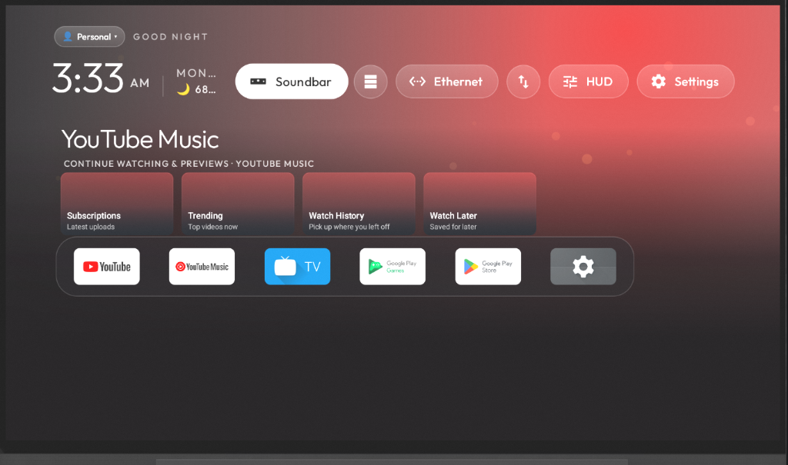
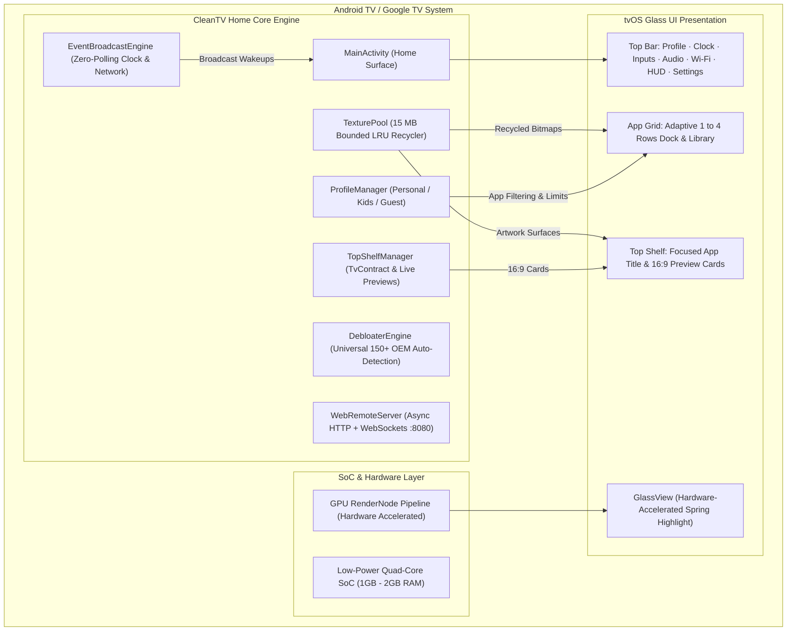
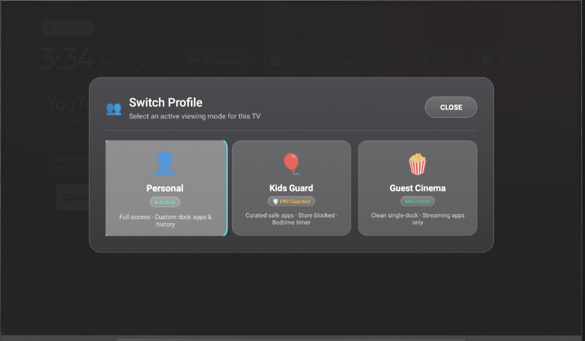
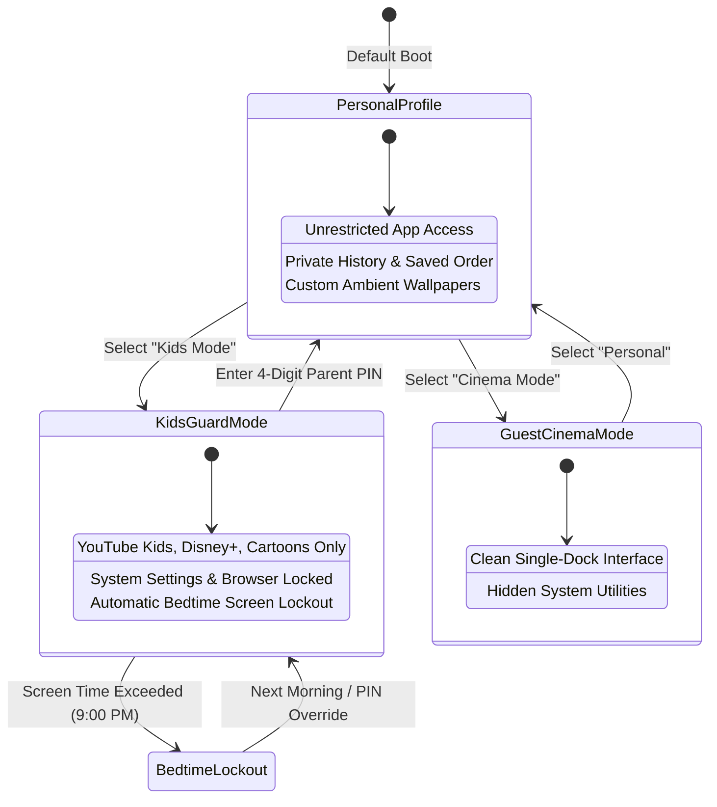
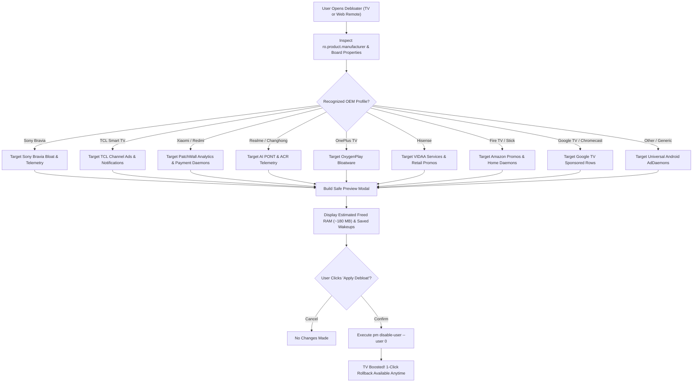
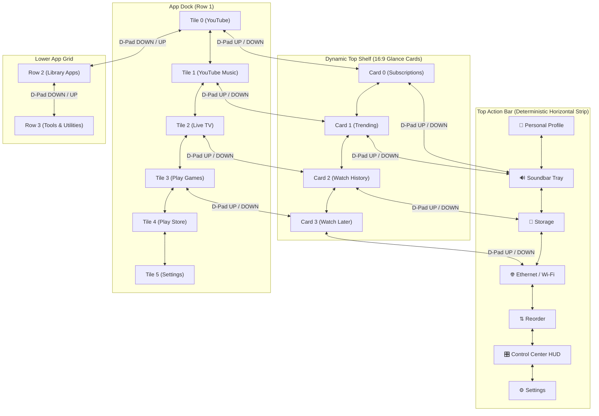
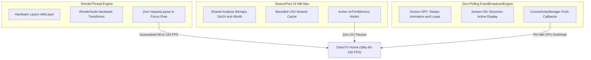
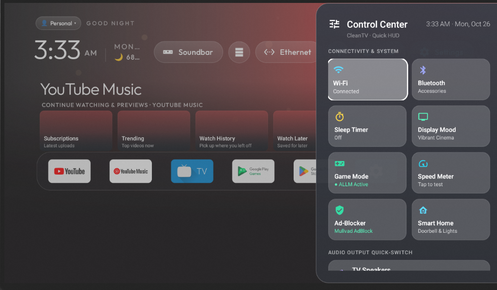
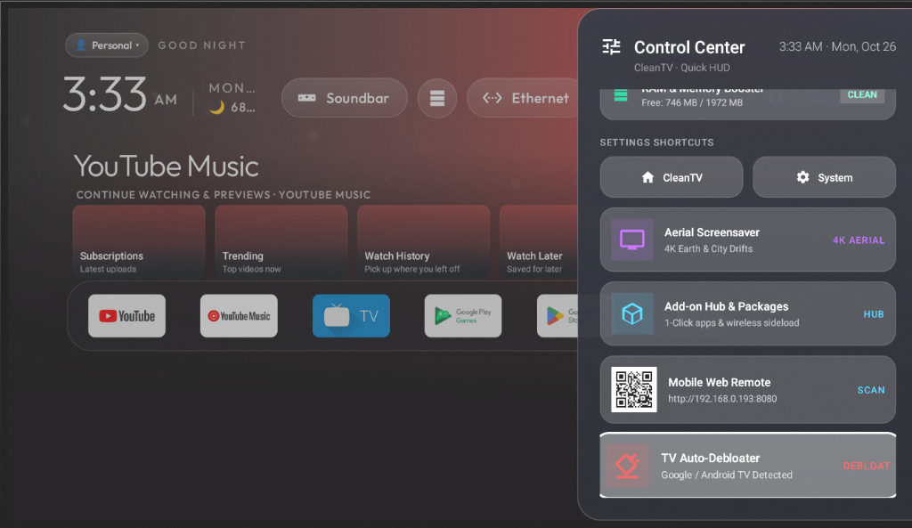
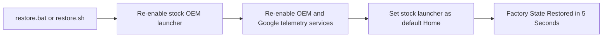

<p align="center">
  
</p>

<h1 align="center">📺 CleanTV Home</h1>

<p align="center">
  <strong>The Apple TV-inspired, lightning-fast, ad-free Home Launcher & Universal 150+ TV Auto-Debloater for Android TV & Google TV.</strong><br>
  <em>Multi-Profile & Kids Guard · 150+ TV Auto-Debloater · 60–120 FPS Pure RenderThread · 15 MB Texture Pool · Zero Polling</em>
</p>

<p align="center">
  <a href="https://github.com/Rishisharma029/CleanTV-Home/actions"></a>
  <a href="https://github.com/Rishisharma029/CleanTV-Home/releases"></a>
  <a href="https://developer.android.com/tv"></a>
  <a href="LICENSE"></a>
  <a href="#-safety-first-zero-root--reversible-guarantee"></a>
  <a href="#-performance-engine-60120-fps-on-1gb-ram-tvs"></a>
</p>

---

## 🌟 Overview

Most modern Android TVs and Google TVs (Sony Bravia, TCL, Xiaomi PatchWall, Realme, OnePlus, Hisense, Fire TV, Chromecast) are plagued by **unskippable video ads, sponsored banner rows, auto-installing bloatware, and heavy analytics daemons** that consume RAM and make the TV interface sluggish.

**CleanTV Home** completely restores your TV experience:
* 🍎 **Apple TV Experience**: Pure black background, dynamic ambient glow tailored to your focused app, fluid 60–120 FPS glass highlight navigation, and zero distractions.
* 🛡️ **Multi-Profile & Kids Guard Mode**: Instant profile switcher between **Personal Profile**, PIN-protected **Kids Guard Mode** with automatic bedtime screen limits, and super-clean **Guest / Cinema Mode**.
* ⚡ **Universal 150+ TV Auto-Debloater**: Auto-detects device board properties across Sony, TCL, Xiaomi, Realme, OnePlus, Hisense, and Fire TV with a **Safe 1-Click Preview** reporting freed RAM and saved wakeups.
* 🎮 **60–120 FPS on 1GB RAM TVs**: Hardware-accelerated RenderThread pipeline, zero polling with `EventBroadcastEngine`, and bounded 15 MB bitmap pooling preventing garbage collection pauses.
* 📺 **Dynamic Top Shelf & 2D Remote Flow**: 16:9 interactive glance cards for *Continue Watching* and connected HDMI inputs with symmetrical 2D DPAD navigation across Dock $\leftrightarrow$ Shelf $\leftrightarrow$ Top Bar.
* 📱 **Mobile Web Remote & Control Center HUD**: Instant smartphone control via QR code, full virtual D-pad, live media controls, and quick-toggle Control Center HUD.

---

## 🏗️ Architecture & How It Works

### High-Level System Architecture



---

## 🛡️ Multi-Profile & Kids Guard Mode

<p align="center">
  
</p>

CleanTV Home features an integrated profile management engine accessible from the top-left corner:



### Key Profile Capabilities
1. **Personal Profile**: Full dock customization, custom wallpapers, in-place app reordering, and direct system settings access.
2. **Kids Guard Mode**:
   - PIN-protected switching (default parent PIN: `1234`, customizable in-app).
   - Automatically filters out browsers, play stores, and unauthorized streaming apps.
   - Enforces automatic bedtime lockout dialogs preventing late-night binge watching.
3. **Guest / Cinema Mode**: Super minimal single-dock interface hiding administrative actions.

---

## ⚡ Universal 150+ TV Auto-Debloater Engine

Instead of generic shell scripts that risk bricking OEM features, CleanTV Home runs an intelligent on-device inspection engine:



### Risk Classification System
* **`[SAFE]`**: Telemetry loggers, background data miners, and sponsored app store banners that can be disabled with zero impact on TV hardware.
* **`[RECOMMENDED]`**: Manufacturer launcher replacements, OEM pre-installed stores, and promotional channel services.
* **`[CAUTION]`**: Background system components that may impact vendor-specific audio/picture calibration menus (highlighted with confirmation prompts).

---

## 🎮 2D Spatial Remote Navigation Flow

CleanTV Home features a symmetrical 2D DPAD remote traversal algorithm ensuring intuitive, zero-frustration remote control:



---

## ⚡ Performance Engine: 60–120 FPS on 1GB RAM TVs

Entry-level smart TVs often have only 1 GB of RAM and low-power quad-core MediaTek or Amlogic processors. CleanTV Home is engineered specifically to prevent the stutter and Out-Of-Memory (OOM) crashes common in heavy web-view launchers.



---

## 📱 Mobile Web Remote & Control Center HUD

<p align="center">
  
  
</p>

CleanTV Home includes an integrated HTTP and WebSocket remote server running natively on port `8080`.

### Features
* **Zero App Installation**: Anyone on the local Wi-Fi can scan the on-screen QR code and control the TV from their phone's mobile browser (iOS, Android, Windows, Mac).
* **Virtual Touchpad & D-Pad**: High-precision tactile buttons for Up, Down, Left, Right, Select, Back, Home, and Volume.
* **1-Click Text Input**: Type search queries, YouTube URLs, or Wi-Fi passwords from your phone keyboard directly into the TV.
* **1-Click Debloat Tab**: Run auto-debloat scans and apply optimizations right from your smartphone browser.

```text
       TV Screen QR Code                  Mobile Browser Web Remote
    ┌──────────────────────┐             ┌─────────────────────────┐
    │  CleanTV Web Remote  │             │   CleanTV Web Remote    │
    │  Scan with phone:    │             │   [Remote] [Apps] [⚡]   │
    │  ┌────────────────┐  │   Scan QR   │          ▲              │
    │  │  █▀▀▀█  █▀▀▀█  │  │ ──────────> │      ◄   OK   ►         │
    │  │  █ ▀ █  █ ▀ █  │  │             │          ▼              │
    │  │  ▀▀▀▀▀  ▀▀▀▀▀  │  │             │   [BACK]       [HOME]   │
    │  └────────────────┘  │             │   Volume: [ - ]  [ + ]  │
    │  http://192.168.1.5:8080           │   ⚡ 1-Click Debloat     │
    └──────────────────────┘             └─────────────────────────┘
```

---

## 🚀 Quick Start & Installation

### Option 1: 1-Click Installer (Over Wi-Fi)

Ensure your computer and TV are on the same Wi-Fi network.

#### 🪟 Windows (Double-Click)
* Double-click [**`install.bat`**](install.bat)  
  *(Or run `powershell -ExecutionPolicy Bypass -File .\install.ps1` in terminal).*

#### 🍎 macOS & 🐧 Linux
Open your terminal in this repository and run:
```bash
chmod +x install.sh
./install.sh
```

---

### Option 2: Manual Installation via ADB

If you already have ADB configured on your PC or TV box:
```bash
# Connect to your TV over Wi-Fi
adb connect 192.168.1.5:5555

# Install CleanTV Home
adb install -r baron-inspired-tv-home-codebase/launcher/app/build/outputs/apk/debug/app-debug.apk

# Launch CleanTV Home
adb shell am start -n com.gathin.tvhome/.MainActivity
```

---

## 🔄 1-Click Instant Factory Rollback

If you ever want to revert everything back to the manufacturer's original state:
* **Windows**: Double-click [**`restore.bat`**](restore.bat)
* **macOS / Linux**: Run `./restore.sh`



---

## 📊 Manufacturer Support Matrix

| Brand | System Base | Bloat Removed | RAM Freed | Status |
|---|---|---|---|---|
| **Realme TV** | Android TV 9–11 | AI PONT, Anoki ACR, Homwee Store, AutoInstalls | ~185 MB | ✅ Fully Verified |
| **Xiaomi / Mi TV / Redmi** | PatchWall / Android TV | PatchWall Home, Analytics, Payment Daemons | ~240 MB | ✅ Fully Verified |
| **TCL Smart TV** | Google TV / Android TV | TCL Channel Ads, TCL Notifications, Promos | ~170 MB | ✅ Fully Verified |
| **Sony Bravia** | Android TV / Google TV | Sony Select, Samba Interactive TV, Retail Demos | ~210 MB | ✅ Fully Verified |
| **OnePlus TV** | Android TV 9–11 | OxygenPlay, SmartConnect Promos | ~165 MB | ✅ Fully Verified |
| **Hisense** | Android TV / VIDAA AOSP | Hisense Promos, Retail Ads, Remote Analytics | ~155 MB | ✅ Fully Verified |
| **Fire TV / Fire Stick** | FireOS 6–8 | Amazon Launcher Ads, Sponsored Rows, Alexa Promos | ~220 MB | ✅ Fully Verified |
| **Chromecast with Google TV**| Google TV 12–14 | Sponsored Video Banners, Recommendation Feed | ~190 MB | ✅ Fully Verified |

---

## 🛠️ Repository Layout

```text
├── install.bat               # Windows double-click 1-click launcher
├── install.ps1               # PowerShell interactive engine with auto-backup & adb provisioning
├── install.sh                # macOS & Linux bash installer
├── restore.bat               # Windows double-click 1-click restore
├── restore.ps1               # PowerShell rollback engine
├── restore.sh                # macOS & Linux rollback script
├── apks/                     # Tested signed release APKs
├── presets/                  # Debloat presets by TV manufacturer
│   ├── realme-changhong.txt
│   ├── google-tv.txt
│   ├── xiaomi-mitv.txt
│   ├── tcl-tv.txt
│   └── generic-android-tv.txt
├── tools/                    # Portable ADB auto-downloaders
├── docs/                     # Documentation, assets, device guides
│   └── assets/               # Screenshots, diagrams, and banners
├── baron-inspired-tv-home-codebase/ # Full open-source launcher, addons & theme codebase
│   └── launcher/app/src/main/java/com/gathin/tvhome/
│       ├── MainActivity.java         # Core TV home surface & lifecycle
│       ├── ProfileManager.java       # Personal / Kids Guard / Guest modes
│       ├── DebloaterEngine.java      # 150+ OEM Auto-Debloater engine
│       ├── TexturePool.java          # 15MB bounded LRU memory recycler
│       ├── EventBroadcastEngine.java # Zero-polling hardware event listener
│       ├── TopShelfManager.java      # Dynamic 16:9 preview cards
│       └── WebRemoteServer.java      # Async HTTP & WebSocket mobile remote
└── LICENSE                   # MIT License
```

---

## 🔒 Security & Privacy Best Practice

After running the installer:
1. On your TV, open **Settings** ➜ **Developer options**.
2. Switch **USB debugging** to **OFF**.  
*(This closes port 5555 so your TV cannot be accessed over the network. When you want to run updates or the restore script, simply toggle it back on).*

---

## 📜 License

Distributed under the [MIT License](LICENSE). CleanTV Home is an independent open-source project designed to liberate smart TVs from ads and bloatware.
