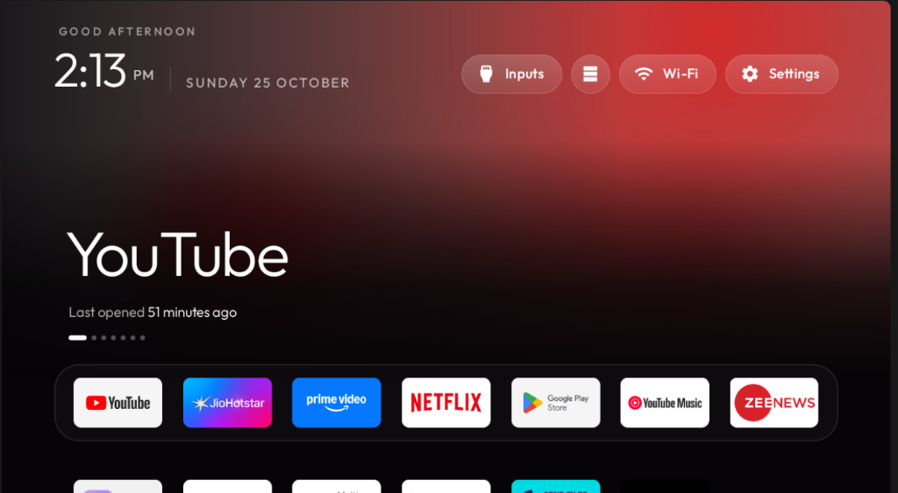
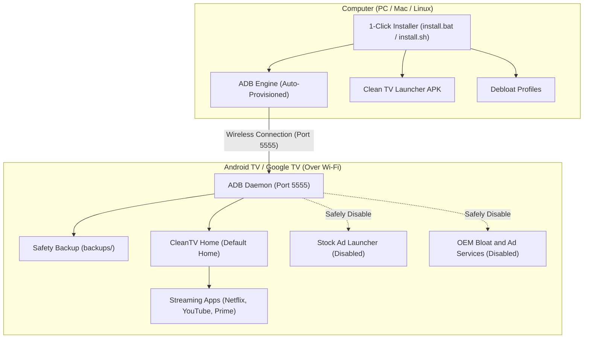
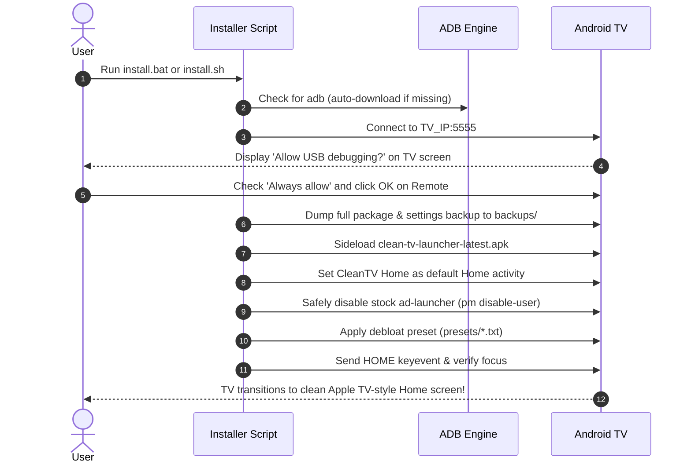
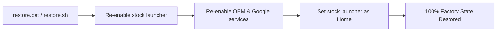

<p align="center">
  
</p>

<h1 align="center">📺 CleanTV Home</h1>

<p align="center">
  <strong>The Apple TV-inspired, lightning-fast, ad-free Home Launcher & 1-Click Debloater for Android TV & Google TV.</strong><br>
  <em>No root required · Zero cables · Runs over Wi-Fi · Zero build dependencies · 1-click instant factory rollback</em>
</p>

<p align="center">
  <a href="https://github.com/Rishisharma029/CleanTV-Home/actions"></a>
  <a href="https://github.com/Rishisharma029/CleanTV-Home/releases"></a>
  <a href="https://developer.android.com/tv"></a>
  <a href="LICENSE"></a>
  <a href="#-safety-first-zero-root--reversible-guarantee"></a>
</p>

---

## 🌟 Overview

Most modern Android TVs and Google TVs (Realme, Xiaomi, TCL, Hisense, Chromecast) are plagued by **unskippable video ads, sponsored banner rows, auto-installing bloatware, and heavy analytics daemons** that consume RAM and make the TV interface sluggish.

**CleanTV Home** completely restores your TV experience:
* 🍎 **Apple TV Experience**: Pure black background, dynamic ambient glow tailored to your focused app, fluid 60fps glass highlight navigation, and zero distractions.
* ⚡ **Ultra-Lean Native Launcher**: Tiny ~530 KB binary footprint. Starts in milliseconds without cold-boot stutters.
* 📦 **Pre-Compiled & Zero Setup**: Includes tested, ready-to-install release APKs (`com.gathin.tvhome`). No need to install Java, Android SDK, or build tools.
* 🔌 **Zero-Dependency ADB**: The installer auto-detects or downloads standalone Google Android platform-tools directly—anyone can run it.
* 🛡️ **100% Safe & Reversible**: Does **not** permanently delete any system files. Uses standard Android `pm disable-user --user 0`. If you change your mind, a single click on `restore.bat` restores the stock factory TV launcher in 5 seconds.

---

## 🏗️ Architecture & How It Works

### System Lifecycle & Architecture



### Installation Sequence



---

## 🚀 Quick Start Guide

### Step 1: Enable USB Debugging on your TV
1. On your TV remote, navigate to **Settings** (⚙️) ➜ **Device Preferences** (or **System**) ➜ **About**.
2. Scroll to **Build** (or **Android TV OS build**) and click the **Center / OK button 7 times** until the toast message says *"You are now a developer!"*
3. Go back one level ➜ open **Developer options** ➜ turn **USB debugging** to **ON**.  
   *(If you see **Network debugging** or **Wireless debugging**, turn that ON as well).*
4. Check your TV's local IP address under **Settings** ➜ **Network & Internet** (e.g., `192.168.0.159`).

---

### Step 2: Run the 1-Click Installer

Ensure your computer and TV are on the same Wi-Fi network.

#### 🪟 Windows (Double-Click)
* Double-click [**`install.bat`**](install.bat)  
  *(Or run `powershell -ExecutionPolicy Bypass -File .\install.ps1` in terminal).*

#### 🍎 macOS & 🐧 Linux
Open your terminal in this repository and run:
```bash
chmod +x install.sh
./install.sh
```

---

### Step 3: Accept the Remote Prompt on Your TV Screen
When the script initiates the connection:
1. Look at your TV screen for the dialog: **"Allow USB debugging?"**
2. Check `[x] Always allow from this computer`.
3. Click **OK / Allow** using your TV remote.

The installer will automatically snapshot your system, sideload the launcher, set it as Home, and disable background ad daemons!

---

## 🔄 1-Click Instant Factory Rollback

If you ever want to revert everything back to the manufacturer's original state:
* **Windows**: Double-click [**`restore.bat`**](restore.bat)
* **macOS / Linux**: Run `./restore.sh`



---

## 🛡️ Safety First: Zero-Root & Reversible Guarantee

| Feature | Standard "Debloaters" | CleanTV Home |
|---|---|---|
| **Root Required** | Often Yes / Risky | **NO (Zero Root required)** |
| **System Modification** | Deletes APKs (`pm uninstall`) | **Non-destructive (`pm disable-user`)** |
| **Recovery Method** | Requires factory reset / firmware flash | **Instant 1-click script (`restore.bat`)** |
| **Pre-Install Backup** | None | **Automated full snapshot in `backups/`** |
| **Brick Risk** | High | **Zero — fallback logic auto-restores stock Home if verification fails** |

---

## 🎨 Features & Capabilities

```
+----------------------------------------------------------------------------------------+
| GOOD AFTERNOON                                                                        |
| 2:13 PM  |  SUNDAY 25 OCTOBER              [Inputs] [Storage] [Wi-Fi] [Settings]       |
|                                                                                        |
| YouTube                                                                                |
| Last opened 51 minutes ago                                                             |
| ......                                                                                 |
|                                                                                        |
| [ YouTube ] [ JioHotstar ] [ Prime Video ] [ Netflix ] [ Play Store ] [ YT Music ] [Zee]|
+----------------------------------------------------------------------------------------+
```

* **Custom Dock Sizing**: Supports 4 to 7 dock apps that fit cleanly at 720p, 1080p, and 4K UHD resolutions.
* **In-Place Tile Reordering**: Hold **OK / Select** on your remote over any dock tile to move it up, down, first, or last without opening setting menus.
* **Storage Dashboard**: Direct live memory indicator at the top bar reporting free/used space.
* **HDMI Input Switcher**: Instant switching between HDMI 1, HDMI 2, AV, and Live TV.
* **Dynamic Accent Glow**: The top shelf smoothly casts ambient glow matching the accent colors of the selected app.

---

## 📊 Manufacturer Debloat Presets

CleanTV Home includes battle-tested debloat profiles in the [**`presets/`**](presets/) folder:

* **Realme TV / Changhong AI PONT** (`presets/realme-changhong.txt`): Disables `tv.anoki.acr.controller` (ACR telemetry), `com.homwee.aipont`, `com.google.android.tvrecommendations`, `android.autoinstalls.config.homwee`, `com.homwee.store`, and `com.homwee.help`.
* **Google TV / Chromecast** (`presets/google-tv.txt`): Disables sponsored ad rows, promotional banners, and sync daemons.
* **Xiaomi / Mi TV / Redmi** (`presets/xiaomi-mitv.txt`): Disables heavy PatchWall ads, payment daemons, and `com.miui.analytics`.
* **TCL Smart TV** (`presets/tcl-tv.txt`): Disables TCL ad services and promotional notifications.
* **Generic Android TV** (`presets/generic-android-tv.txt`): Universal safe list compatible with all standard Android TV sets.

---

## 🛠️ Repository Layout

```text
├── install.bat               # Windows double-click 1-click launcher
├── install.ps1               # PowerShell interactive engine with auto-backup & adb provisioning
├── install.sh                # macOS & Linux bash installer
├── restore.bat               # Windows double-click 1-click restore
├── restore.ps1               # PowerShell rollback engine
├── restore.sh                # macOS & Linux rollback script
├── apks/                     # Tested signed release APKs
│   ├── clean-tv-launcher-latest.apk   # Latest v3.5 (Storage + Tile reordering)
│   ├── clean-tv-launcher-v3.4.apk
│   └── clean-tv-launcher-v2.8.apk
├── presets/                  # Debloat presets by TV manufacturer
│   ├── realme-changhong.txt
│   ├── google-tv.txt
│   ├── xiaomi-mitv.txt
│   ├── tcl-tv.txt
│   └── generic-android-tv.txt
├── tools/                    # Portable tooling
│   ├── get-adb.ps1           # Standalone ADB auto-downloader (Windows)
│   ├── get-adb.sh            # Standalone ADB auto-downloader (macOS/Linux)
├── docs/                     # Documentation, assets, device guides
│   └── assets/               # Screenshots, diagrams, and banners
├── baron-inspired-tv-home-codebase/ # Full open-source launcher, addons & theme codebase
├── .github/                  # CI/CD workflows, issue templates, security scan
├── SECURITY.md               # Security policy & responsible disclosure
├── CODE_OF_CONDUCT.md        # Contributor Covenant Code of Conduct
├── CONTRIBUTING.md           # Contribution guidelines
└── LICENSE                   # MIT License
```

---

## 🔒 Security & Privacy Best Practice

After running the installer:
1. On your TV, open **Settings** ➜ **Developer options**.
2. Switch **USB debugging** to **OFF**.  
*(This closes port 5555 so your TV cannot be accessed over the network. When you want to run updates or the restore script, simply toggle it back on).*

---

## 🤝 Contributing

Contributions, device reports, and debloat profiles are welcome!
1. Check [**`CONTRIBUTING.md`**](CONTRIBUTING.md) for guidelines.
2. Submit a device report via [**Issue Templates**](https://github.com/Rishisharma029/CleanTV-Home/issues).

---

## 📜 License

Distributed under the [MIT License](LICENSE).  
CleanTV Home is based on the CleanYourTV project.
